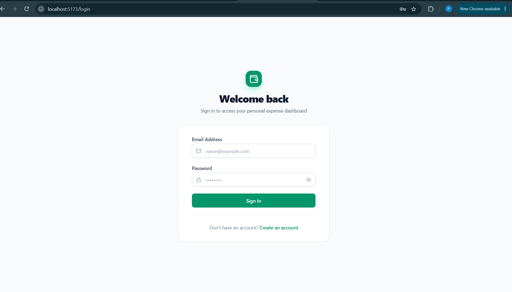
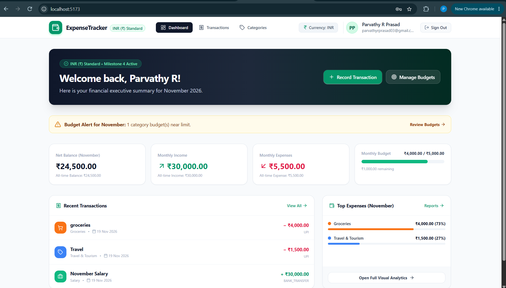
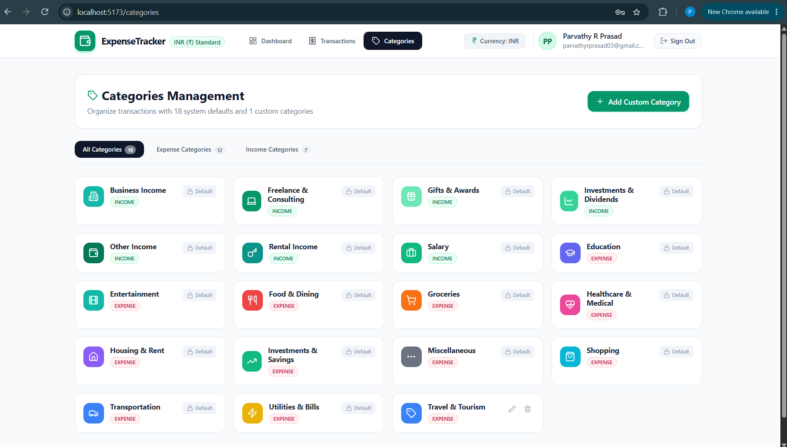
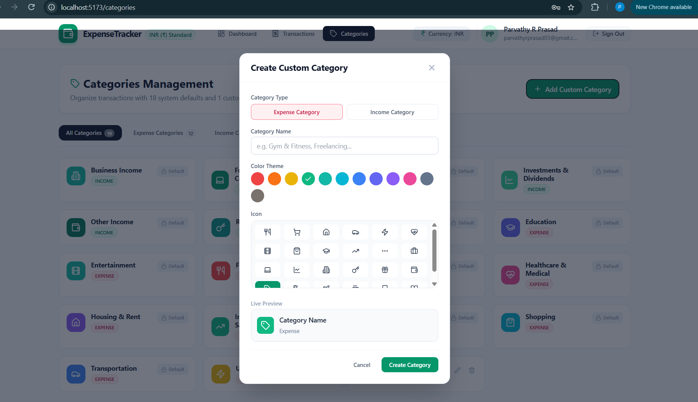
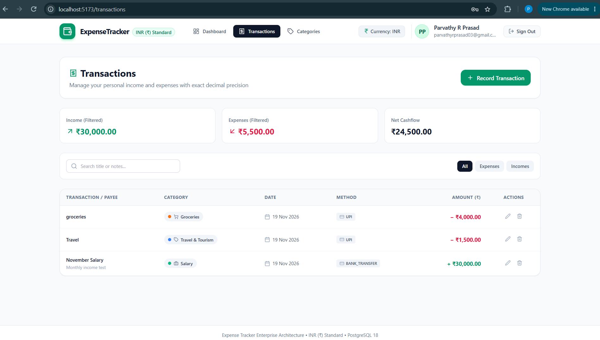
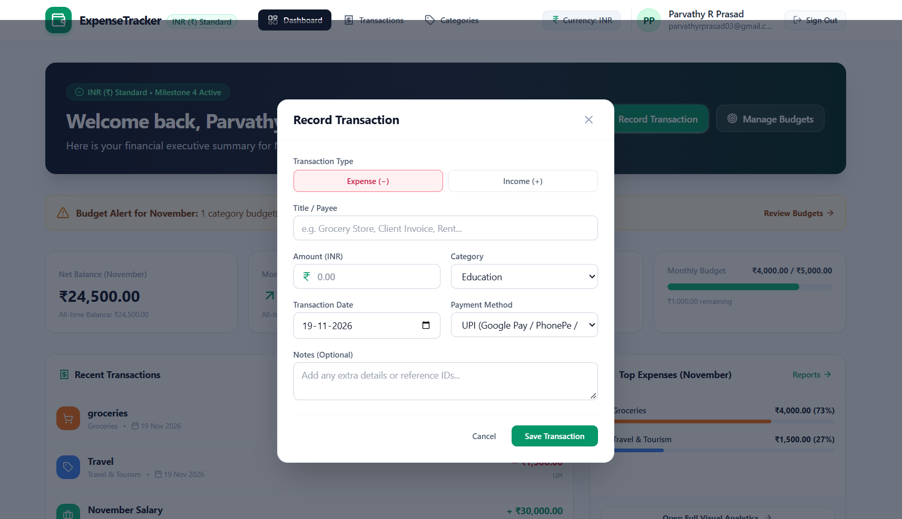
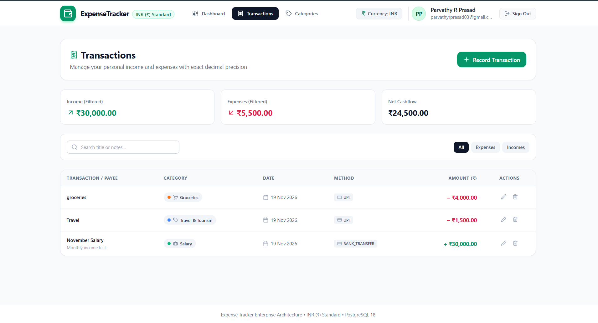
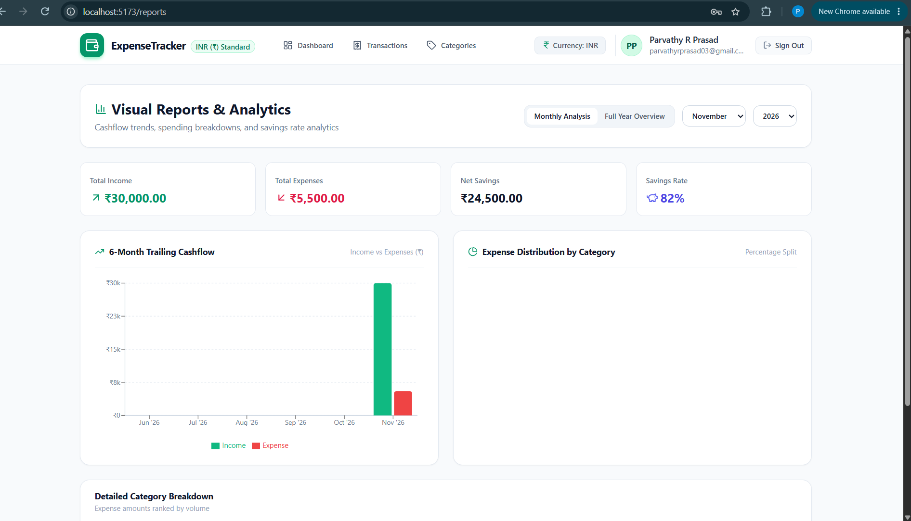

# Expense Tracker Application

A modern, responsive personal finance and expense tracking application built using React, TypeScript, Node.js, Express, PostgreSQL and Prisma ORM.

The application helps users manage income and expenses, organise transactions by category, monitor budgets and view financial analytics through a dashboard.

## 1. Project Overview

**Project Name:** Expense Tracker

**Application Type:** Full-stack web application

**Currency:** Indian Rupee (INR – ₹)

### Key Features

- User registration and login.
- Secure password hashing using bcrypt.
- JWT-based authentication.
- Protected application routes.
- Dashboard with financial summaries.
- Income and expense transaction management.
- Add, edit and delete transactions.
- Category management.
- Budget management.
- Financial reports and visual analytics.
- Payment method selection.
- PostgreSQL database integration.
- Input validation and error handling.
- Responsive user interface.

## 2. Technologies Used

| Area | Technologies |
|---|---|
| Frontend | React 18, TypeScript |
| Build Tool | Vite 6 |
| Styling | Tailwind CSS |
| Backend | Node.js, Express.js, TypeScript |
| Database | PostgreSQL |
| ORM | Prisma 6 |
| Authentication | JWT, bcrypt |
| Validation | Zod |
| Data Visualisation | Recharts |
| Testing | Vitest, Supertest, React Testing Library |
| Containerisation | Docker |

## 3. Project Architecture

The application follows a decoupled frontend and backend architecture.

- **Frontend:** React application responsible for the user interface.
- **Backend:** Express REST API responsible for business logic and API operations.
- **Database:** PostgreSQL stores user, transaction, category and budget information.
- **ORM:** Prisma manages database queries and schema operations.

### Database Modules

- Users – User credentials, profile information and authentication data.
- Categories – Default and custom income and expense categories.
- Transactions – Income and expense records.
- Budgets – Monthly budgets associated with users and categories.

## 4. Project Folder Structure

```text
ExpenseTracker/
│
├── client/
│   ├── src/
│   │   ├── components/
│   │   ├── features/
│   │   ├── context/
│   │   └── ...
│   ├── package.json
│   └── vite.config.ts
│
├── server/
│   ├── prisma/
│   ├── src/
│   ├── .env.example
│   └── package.json
│
├── .agents/
│   └── skills/
│       ├── add-feature-workflow/
│       │   └── SKILL.md
│       └── code-review-checklist/
│           └── SKILL.md
│
├── .githooks/
│   ├── pre-commit
│   └── pre-commit.cmd
│
├── screenshots/
├── AGENTS.md
├── AI_PERMISSIONS.md
├── AI_USAGE_LOG.md
├── AI_REFLECTION.md
├── README.md
└── package.json
```

## 5. Installation and Setup

### Prerequisites

Install the following:

- Node.js
- npm
- PostgreSQL
- Docker Desktop (if using the PostgreSQL Docker container)
- Git

### Step 1: Clone the Repository

```bash
git clone YOUR_GITHUB_REPOSITORY_URL
cd ExpenseTracker
```

Replace `YOUR_GITHUB_REPOSITORY_URL` with your actual GitHub repository URL.

### Step 2: Install Dependencies

```bash
npm install
```

### Step 3: Configure Environment Variables

Create a backend environment file using the example configuration.

On Windows CMD:

```cmd
copy server\.env.example server\.env
```

Open `server/.env` and configure the database connection and authentication settings.

Important environment variables:

| Variable | Description |
|---|---|
| PORT | Backend server port |
| NODE_ENV | Application environment |
| DATABASE_URL | PostgreSQL connection URL |
| JWT_SECRET | Secret used for JWT authentication |
| JWT_EXPIRES_IN | JWT expiration duration |
| CORS_ORIGIN | Frontend origin |
| DEFAULT_CURRENCY | Default currency code |
| DEFAULT_CURRENCY_SYMBOL | Currency symbol |

Use your own secure database credentials and JWT secret. Do not commit the actual `.env` file.

### Step 4: Configure PostgreSQL

Ensure PostgreSQL is running and create the database:

```text
expensetracker_db
```

Update `DATABASE_URL` in `server/.env` with your PostgreSQL username, password, host and database name.

### Step 5: Generate Prisma Client and Run Migrations

```bash
npm --prefix server run prisma:generate
npm --prefix server run prisma:migrate
```

### Step 6: Start the Backend

```bash
npm run dev:server
```

Backend URL:

```text
http://localhost:5000
```

Health check:

```text
http://localhost:5000/api/health
```

### Step 7: Start the Frontend

Open another terminal in the project root:

```bash
npm run dev:client
```

Frontend URL:

```text
http://localhost:5173
```

## 6. Testing

The project uses Vitest, Supertest and React Testing Library.

Run backend tests:

```bash
npm run test:server
```

Run frontend tests:

```bash
npm run test:client
```

Run all tests:

```bash
npm test
```

**Verified test results:**

- Backend: 42 tests passed.
- Frontend: 9 tests passed.
- Total: 51 tests passed.

### Production Build

```bash
npm run build
```

The backend TypeScript compilation and frontend production build completed successfully.

## 7. Application Screenshots

The following screenshots demonstrate the application's user interface and major features.

### Login



### Dashboard



### Categories



### Add Categories



### Transactions



### Record Transaction



### Transaction Details



### Visual Analytics



## 8. AI-Assisted Development Workflow

AI-assisted development practices and supporting documents are included in this repository.

### Project Rules

`AGENTS.md`

Contains project architecture, technology stack, coding standards, development commands, important restrictions and definition of done.

### Skill 1: Add Feature Workflow

`.agents/skills/add-feature-workflow/SKILL.md`

Defines a structured process for understanding requirements, planning, obtaining approval, implementing changes and testing new features.

### Skill 2: Code Review Checklist

`.agents/skills/code-review-checklist/SKILL.md`

Provides a checklist for reviewing correctness, security, validation, code quality and test coverage.

### Git Pre-commit Hook

`.githooks/pre-commit`

Runs the project test suite before allowing a Git commit.

The hook was tested successfully, and all 51 tests passed during commit verification.

To configure Git to use the repository hooks:

```bash
git config core.hooksPath .githooks
```

### AI Permissions

`AI_PERMISSIONS.md`

Documents the approval-based AI permission approach and the actions that require user approval.

### AI Usage Log

`AI_USAGE_LOG.md`

Documents AI prompts, generated outputs, identified limitations and changes made during development.

### AI Reflection

`AI_REFLECTION.md`

Describes the experience of using AI-assisted development, its benefits and areas requiring human verification.

## 9. Git Version Control

The project uses Git for source control and meaningful commits.

Recent commits:

```text
7c01113 Add AI workflow documentation, skills, and pre-commit hook
1291a74 Add budget and reports navigation
```

## 10. Important Implementation Note

This repository contains a full-stack web-based Expense Tracker using PostgreSQL persistence.

It is not a command-line application using local JSON/CSV persistence. If the assessment requires the CLI implementation specifically, confirm with the evaluator whether this web implementation is acceptable.

## 11. Conclusion

The Expense Tracker demonstrates full-stack application development using React, TypeScript, Node.js, Express and PostgreSQL.

It also includes testing, Git version control, AI-assisted development rules, reusable AI skills, a pre-commit testing hook and supporting development documentation.